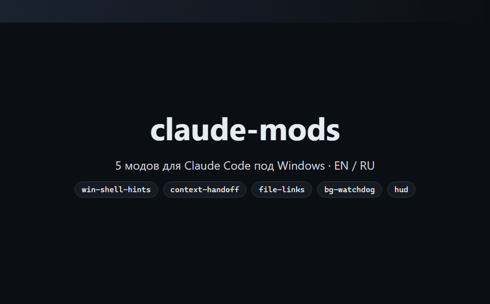

# claude-mods

[English](#english) · [Русский](#русский)

## English

<p align="center"></p>
<p align="center"><sub>claude-mods in action (illustration)</sub></p>

Twelve Claude Code mods built for Windows: they catch what breaks there, keep auto mode safe, tell you when Claude needs you, and save the clicks around a session. Each one speaks English or Russian (`language` in `/config`; `auto`, the default, follows `LANG` or the Windows language), works on its own and works better next to the others.

### The mods

**Windows shells**

| Mod | What it does |
| --- | --- |
| [`win-shell-hints`](win-shell-hints) | Catches commands that would fail on Windows before they run: bash syntax in PowerShell 5.1 (`&&`, `grep`, `head`, `rm -rf`, `curl -s`, `python3`), Windows paths or `%VAR%` in Git Bash. It refuses the line and tells Claude the correct form right away. |
| [`encoding-guard`](encoding-guard) | Keeps Cyrillic intact: adds `-Encoding UTF8` to PowerShell 5.1's `Get-Content`, stops `Set-Content` / `Add-Content` that would save text as cp1251, runs Python and git in UTF-8 for the session (`PYTHONUTF8=1`, `core.quotepath=false`, your config untouched), and explains mojibake, `�` and `UnicodeEncodeError` to Claude. |

**Safety in auto mode**

| Mod | What it does |
| --- | --- |
| [`danger-guard`](danger-guard) | `git reset --hard`, `clean -f`, `checkout -- .`, `branch -D`, `stash drop` run after a snapshot of the whole tree (restore with `/guard`); force push, `rm -rf` outside the project, `DROP TABLE`, `terraform destroy` and the like wait for your answer. |
| [`test-watch`](test-watch) | Runs the tests after a turn in which Claude changed files (and did not run them itself): ⟳ / ✓ / ✗ above the prompt, a failure goes to Claude in one click. Asks once per project; the command is found from the project (npm / pnpm / yarn / bun, pytest, cargo, go, dotnet, `claude plugin test` for changed plugins). `/tests`. |

**Knowing what happens**

| Mod | What it does |
| --- | --- |
| [`hud`](hud) | A three-line HUD under the prompt (or above it): model, folder, git branch with uncommitted / ahead / behind; bars for the context and the 5-hour limit, the weekly limit, when each resets; a countdown until the prompt cache goes cold. Click the folder to open Claude Code in another folder, the branch to open `/changes`, 📷 to take a screenshot. |
| [`turn-notify`](turn-notify) | A Windows notification when a turn of 30 seconds or more ends, or when Claude waits for permission, an answer or plan approval, while the terminal is not in front. With notifications off in Windows it flashes the taskbar button with a sound; with a Telegram bot set up, it writes there once you have been away 5 minutes. `/notify test`. |
| [`changes-pane`](changes-pane) | `/changes` opens a pane of the files changed since the session started: git status, +/− line counts, open in VS Code; a click unfolds the diff. Files that were already dirty before the session are listed apart. |
| [`bg-watchdog`](bg-watchdog) | Watches the session's background tasks and the dev servers it started on ports. Anything running longer than 20 minutes gets a bar with Stop / Snooze / Hide. Everything at once: `/bg-tasks`. |

**Prompt and context**

| Mod | What it does |
| --- | --- |
| [`shot`](shot) | `/shot` puts a screenshot into the prompt: a region (the Windows snipping overlay), `window` (the window behind the terminal, whole even where the terminal covers it), `screen` or `clip`. Several fit in one message through the HUD's 📷 buttons. |
| [`prompt-snippets`](prompt-snippets) | `;name` in the prompt expands to a saved snippet (suggestions as you type, or when sent as it is); `/snip save name` keeps the last prompt, `/snip` lists them all. Shared by every project. |
| [`file-links`](file-links) | Turns file mentions in Claude's replies into clickable `file:///` links, resolving where each file actually lives. |
| [`context-handoff`](context-handoff) | At 350k / 600k / 800k context tokens it offers to move on: the agent writes `.handoff/handoff-<date>.md`, the chat is cleared, and a fresh agent reads the file and continues. `/handoff` by hand. |

### Better together

The mods talk to each other through Claude Code itself, so each pairing below works as soon as both mods are installed; nothing to set up.

- **`hud` + `changes-pane`**: the branch in the HUD (`⎇ main ●4`) is a button that opens `/changes`, the same changes the `●` counts, file by file with diffs.
- **`hud` + `shot`**: **📷 shot · window** at the end of the HUD's first line take a screenshot without touching what you typed, so several screenshots and your text go in one message.
- **`danger-guard` + `turn-notify`**: the question about an irreversible command is Claude Code's own question dialog, so `turn-notify` sees it like any question: walk away during a long auto-mode task, and a toast (or Telegram) tells you the moment a `git push --force` waits for your answer.
- **`test-watch` + `turn-notify`**: **Hand to Claude** on a failed run starts a new turn; when the fix is done and you are elsewhere, you get the notification.
- **`test-watch` + `changes-pane`**: after a turn, ✓ / ✗ above the prompt says whether it works, `/changes` shows what was changed to get there.
- **`danger-guard` + `changes-pane`**: a **Restore** in `/guard` brings files back, and `/changes` shows exactly which.
- **`win-shell-hints` + `encoding-guard`**: one fixes the syntax of a command for its shell, the other the encoding of what it reads and writes; together PowerShell 5.1 and Git Bash stop being a source of failed turns.
- **`shot` + `prompt-snippets`**: a snippet such as `;bug` = "Here is what I see; find the cause, fix it, show the diff" next to two screenshots is a whole bug report in three clicks.
- **`context-handoff` + `hud`**: the HUD's context bar shows the session filling up; at 350k `context-handoff` offers the move before the agent starts to drift.

### Kits

Install what fits how you work (or everything, below):

- **Auto mode, hands off:** `danger-guard`, `test-watch`, `turn-notify`, `changes-pane`. Let Claude run; irreversible steps wait for you, the tests run themselves, you hear when it is done or stuck, and you review the result file by file.
- **Windows and Cyrillic:** `win-shell-hints`, `encoding-guard`, `file-links`. Fewer failed commands, no mojibake, clickable paths.
- **Long sessions:** `hud`, `context-handoff`, `bg-watchdog`. The context, the limits and the cache in sight, a clean move at the right time, no forgotten dev servers.
- **Show and ask:** `shot`, `prompt-snippets`. Screenshots and your usual requests in a couple of keystrokes.

### Commands

| Command | Mod | What it does |
| --- | --- | --- |
| `/changes` | changes-pane | Files changed in the session, with diffs |
| `/tests` · `run` · `on` · `off` | test-watch | Test output; run now; switch runs for the project |
| `/guard` | danger-guard | Snapshots taken before dangerous git commands, Restore / Delete |
| `/notify` · `test` · `on` · `off` | turn-notify | State; a test notification; mute for the session |
| `/shot` · `window` · `screen` · `clip` | shot | A screenshot into the prompt |
| `/snip` · `save name [text]` · `rm name` | prompt-snippets | Snippets pane; save the last prompt or a text; delete |
| `/bg-tasks` | bg-watchdog | Background tasks and dev servers of the session |
| `/handoff` | context-handoff | Move to a fresh session through a handoff file |
| `/open-project` | hud | Open Claude Code in another folder in a new window |

### Install

In a Claude Code terminal session, one mod at a time (install only the ones you want):

```
/plugin install win-shell-hints --marketplace ArtyaEXE/claude-mods
/plugin install encoding-guard --marketplace ArtyaEXE/claude-mods
/plugin install danger-guard --marketplace ArtyaEXE/claude-mods
/plugin install test-watch --marketplace ArtyaEXE/claude-mods
/plugin install hud --marketplace ArtyaEXE/claude-mods
/plugin install turn-notify --marketplace ArtyaEXE/claude-mods
/plugin install changes-pane --marketplace ArtyaEXE/claude-mods
/plugin install bg-watchdog --marketplace ArtyaEXE/claude-mods
/plugin install shot --marketplace ArtyaEXE/claude-mods
/plugin install prompt-snippets --marketplace ArtyaEXE/claude-mods
/plugin install file-links --marketplace ArtyaEXE/claude-mods
/plugin install context-handoff --marketplace ArtyaEXE/claude-mods
```

Answer `y` to `Add marketplace?`, then pick a scope.

All twelve from PowerShell:

```powershell
'win-shell-hints','encoding-guard','danger-guard','test-watch','hud','turn-notify','changes-pane','bg-watchdog','shot','prompt-snippets','file-links','context-handoff' | ForEach-Object { claude plugin install $_ --marketplace ArtyaEXE/claude-mods -s user }
```

In the desktop app: click + next to the prompt box → Plugins → Add marketplace `ArtyaEXE/claude-mods` → Add plugin.

To update: `/plugin marketplace update claude-mods`, then `/plugin update <mod>`.

### Develop

Each mod is a folder with `.claude-plugin/plugin.json`, `hooks/hooks.json` and one hooks module (`hooks/register.ts[x]`), with its tests beside it. `claude plugin validate <mod> --strict` checks a mod, `claude plugin test <mod>` runs its tests; CI does both for every mod on Windows. Each mod's README says what it touches on your machine.

### License

MIT

---

## Русский

<p align="center"></p>
<p align="center"><sub>claude-mods в деле (иллюстрация)</sub></p>

Двенадцать модов для Claude Code, заточенных под Windows: ловят то, что там ломается, делают авто-режим безопасным, сообщают, когда Claude нужны вы, и экономят клики вокруг сессии. Каждый говорит по-русски и по-английски (`language` в `/config`; `auto` по умолчанию — по `LANG` или языку Windows), работает сам по себе и лучше — рядом с остальными.

### Моды

**Оболочки Windows**

| Мод | Что делает |
| --- | --- |
| [`win-shell-hints`](win-shell-hints) | Ловит команды, которые упадут на Windows, до запуска: bash-синтаксис в PowerShell 5.1 (`&&`, `grep`, `head`, `rm -rf`, `curl -s`, `python3`), Windows-пути и `%VAR%` в Git Bash. Не запускает строку и сразу подсказывает Claude правильный вариант. |
| [`encoding-guard`](encoding-guard) | Бережёт кириллицу: добавляет `-Encoding UTF8` к `Get-Content` в PowerShell 5.1, не даёт `Set-Content` / `Add-Content` сохранить текст в cp1251, запускает Python и git в UTF-8 на время сессии (`PYTHONUTF8=1`, `core.quotepath=false`, ваш конфиг не меняется) и объясняет Claude кракозябры, `�` и `UnicodeEncodeError`. |

**Безопасность в авто-режиме**

| Мод | Что делает |
| --- | --- |
| [`danger-guard`](danger-guard) | `git reset --hard`, `clean -f`, `checkout -- .`, `branch -D`, `stash drop` идут после снимка всего дерева (вернуть — `/guard`); force push, `rm -rf` вне проекта, `DROP TABLE`, `terraform destroy` и подобное ждут вашего ответа. |
| [`test-watch`](test-watch) | Запускает тесты после хода, в котором Claude менял файлы (и не прогнал их сам): ⟳ / ✓ / ✗ над полем ввода, падение отдаётся Claude в один клик. Спрашивает один раз на проект; команда определяется по проекту (npm / pnpm / yarn / bun, pytest, cargo, go, dotnet, `claude plugin test` для изменённых плагинов). `/tests`. |

**Видеть, что происходит**

| Мод | Что делает |
| --- | --- |
| [`hud`](hud) | HUD из трёх строк под полем ввода (или над ним): модель, папка, ветка git (незакоммиченные / ahead / behind); полоски контекста и лимита 5ч, недельный лимит, когда каждый сбросится; таймер, через сколько остынет кэш промптов. Клик по папке открывает Claude Code в другой папке, по ветке — `/changes`, по 📷 — скриншот. |
| [`turn-notify`](turn-notify) | Уведомление Windows, когда закончился ход дольше 30 секунд или Claude ждёт разрешения, ответа или одобрения плана, а терминал не на переднем плане. Если уведомления в Windows выключены — мигает кнопкой на панели задач со звуком; если настроен Telegram-бот — пишет туда, когда вы отошли на 5 минут. `/notify test`. |
| [`changes-pane`](changes-pane) | `/changes` открывает панель файлов, изменённых с начала сессии: статус git, счётчики +/− строк, «открыть» в VS Code; клик раскрывает дифф. Файлы, изменённые ещё до сессии, показаны отдельно. |
| [`bg-watchdog`](bg-watchdog) | Следит за фоновыми задачами сессии и dev-серверами на портах, запущенными в этой сессии. Висит дольше 20 минут — плашка «Остановить / Отложить / Скрыть». Всё сразу: `/bg-tasks`. |

**Промпт и контекст**

| Мод | Что делает |
| --- | --- |
| [`shot`](shot) | `/shot` вставляет скриншот в промпт: область (выделение Windows), `window` (окно за терминалом, целиком, даже там, где его перекрывает терминал), `screen` или `clip`. Несколько снимков в одном сообщении — через кнопки 📷 в HUD. |
| [`prompt-snippets`](prompt-snippets) | `;имя` в промпте разворачивается в сохранённый сниппет (подсказки при наборе или при отправке как есть); `/snip save имя` сохраняет последний промпт, `/snip` показывает все. Общие для всех проектов. |
| [`file-links`](file-links) | Превращает упоминания файлов в ответах Claude в кликабельные `file:///` ссылки, находя, где файл реально лежит. |
| [`context-handoff`](context-handoff) | На 350k / 600k / 800k токенов контекста предлагает переезд: агент пишет `.handoff/handoff-<дата>.md`, чат очищается, новый агент читает файл и продолжает. Вручную: `/handoff`. |

### Вместе лучше

Моды общаются друг с другом через сам Claude Code, поэтому каждая связка ниже работает, как только установлены оба мода, — настраивать ничего не нужно.

- **`hud` + `changes-pane`**: ветка в HUD (`⎇ main ●4`) — кнопка, открывающая `/changes`: те самые изменения, которые считает `●`, по файлам и с диффами.
- **`hud` + `shot`**: **📷 скрин · окно** в конце первой строки HUD делают скриншот, не трогая набранное, так что несколько скриншотов и ваш текст уходят одним сообщением.
- **`danger-guard` + `turn-notify`**: вопрос о необратимой команде — штатное окно вопроса Claude Code, поэтому `turn-notify` видит его как любой вопрос: отойдите во время длинной задачи в авто-режиме, и уведомление (или Telegram) сообщит, как только `git push --force` будет ждать вашего ответа.
- **`test-watch` + `turn-notify`**: «Отдать Claude» при упавших тестах начинает новый ход; когда починка готова, а вы в другом окне, придёт уведомление.
- **`test-watch` + `changes-pane`**: после хода ✓ / ✗ над полем ввода говорит, работает ли, а `/changes` показывает, что ради этого поменялось.
- **`danger-guard` + `changes-pane`**: «Восстановить» в `/guard` возвращает файлы, а `/changes` показывает, какие именно.
- **`win-shell-hints` + `encoding-guard`**: первый исправляет синтаксис команды под оболочку, второй — кодировку того, что она читает и пишет; вместе PowerShell 5.1 и Git Bash перестают быть источником проваленных ходов.
- **`shot` + `prompt-snippets`**: сниппет вроде `;баг` = «Вот что я вижу; найди причину, почини, покажи дифф» рядом с двумя скриншотами — готовый баг-репорт в три клика.
- **`context-handoff` + `hud`**: полоска контекста в HUD показывает, как наполняется сессия; на 350k `context-handoff` предлагает переезд, пока агент не начал «плыть».

### Наборы

Ставьте то, что подходит под вашу работу (или всё сразу, ниже):

- **Авто-режим без присмотра:** `danger-guard`, `test-watch`, `turn-notify`, `changes-pane`. Claude работает сам; необратимые шаги ждут вас, тесты запускаются сами, вы узнаёте, когда готово или застряло, и проверяете результат по файлам.
- **Windows и кириллица:** `win-shell-hints`, `encoding-guard`, `file-links`. Меньше упавших команд, никаких кракозябр, кликабельные пути.
- **Длинные сессии:** `hud`, `context-handoff`, `bg-watchdog`. Контекст, лимиты и кэш на виду, чистый переезд вовремя, никаких забытых dev-серверов.
- **Показать и спросить:** `shot`, `prompt-snippets`. Скриншоты и ваши привычные просьбы в пару нажатий.

### Команды

| Команда | Мод | Что делает |
| --- | --- | --- |
| `/changes` | changes-pane | Файлы, изменённые за сессию, с диффами |
| `/tests` · `run` · `on` · `off` | test-watch | Вывод тестов; запустить сейчас; включить или выключить запуски в проекте |
| `/guard` | danger-guard | Снимки перед опасными git-командами, «Восстановить» / «Удалить» |
| `/notify` · `test` · `on` · `off` | turn-notify | Состояние; тестовое уведомление; выключить до конца сессии |
| `/shot` · `window` · `screen` · `clip` | shot | Скриншот в промпт |
| `/snip` · `save имя [текст]` · `rm имя` | prompt-snippets | Панель сниппетов; сохранить последний промпт или текст; удалить |
| `/bg-tasks` | bg-watchdog | Фоновые задачи и dev-серверы сессии |
| `/handoff` | context-handoff | Переехать в чистую сессию через handoff-файл |
| `/open-project` | hud | Открыть Claude Code в другой папке в новом окне |

### Установка

В терминальной сессии Claude Code, по одному моду (ставьте только нужные):

```
/plugin install win-shell-hints --marketplace ArtyaEXE/claude-mods
/plugin install encoding-guard --marketplace ArtyaEXE/claude-mods
/plugin install danger-guard --marketplace ArtyaEXE/claude-mods
/plugin install test-watch --marketplace ArtyaEXE/claude-mods
/plugin install hud --marketplace ArtyaEXE/claude-mods
/plugin install turn-notify --marketplace ArtyaEXE/claude-mods
/plugin install changes-pane --marketplace ArtyaEXE/claude-mods
/plugin install bg-watchdog --marketplace ArtyaEXE/claude-mods
/plugin install shot --marketplace ArtyaEXE/claude-mods
/plugin install prompt-snippets --marketplace ArtyaEXE/claude-mods
/plugin install file-links --marketplace ArtyaEXE/claude-mods
/plugin install context-handoff --marketplace ArtyaEXE/claude-mods
```

На вопрос `Add marketplace?` ответьте `y`, затем выберите scope.

Все двенадцать из PowerShell:

```powershell
'win-shell-hints','encoding-guard','danger-guard','test-watch','hud','turn-notify','changes-pane','bg-watchdog','shot','prompt-snippets','file-links','context-handoff' | ForEach-Object { claude plugin install $_ --marketplace ArtyaEXE/claude-mods -s user }
```

В десктопном приложении: + рядом с полем ввода → Plugins → Add marketplace `ArtyaEXE/claude-mods` → Add plugin.

Обновить: `/plugin marketplace update claude-mods`, затем `/plugin update <мод>`.

### Разработка

Каждый мод — папка с `.claude-plugin/plugin.json`, `hooks/hooks.json` и одним модулем хуков (`hooks/register.ts[x]`), рядом его тесты. `claude plugin validate <мод> --strict` проверяет мод, `claude plugin test <мод>` запускает его тесты; CI делает и то и другое для каждого мода на Windows. В README каждого мода написано, что он делает в вашей системе.

### Лицензия

MIT
