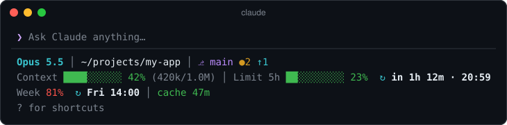
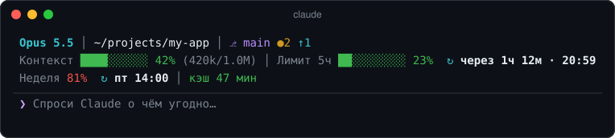

# hud

A three-line HUD under the prompt: model, folder, git, context and 5-hour limit bars, weekly limit with reset times, and a prompt-cache timer.

[English](#english) · [Русский](#русский)

## English

<p></p>

- **Line 1:** model, working folder, git branch with uncommitted (`●`), ahead (`↑`) and behind (`↓`) counts. **Click the folder** to pick another one in an Explorer-style dialog: Claude Code opens there in a new Windows Terminal window (`/open-project` does the same). **Click the branch** to open `/changes`, the pane of the session's changed files from the [changes-pane](../changes-pane) mod. With the [shot](../shot) mod installed, **📷 shot · window** at the end of the line put a screenshot into the prompt without touching what you typed, so several fit in one message.
- **Line 2:** claude-hud-style bars for the context window and the 5-hour limit, side by side, with when the limit resets.
- **Line 3:** weekly limit and its reset, and how long until the prompt cache goes cold since the last reply.

Bars turn yellow past 50% and red past 80%. Refreshes after every turn and every 30 seconds. Sits where a status-line HUD such as claude-hud does, with Claude Code's own hint line kept beneath it.

### What it touches

Reads the session's usage figures (context, rate limits) and model. Every 30 seconds runs `git status --porcelain --branch` in the session folder (read-only). Only when you click the folder or run `/open-project`: shows the Windows folder dialog through PowerShell, then starts `wt.exe -w new -d <folder> cmd /k claude` (or `powershell -NoExit -Command claude` with `shell: powershell`; a plain console window without Windows Terminal). Every 30 seconds reads the list of commands, to show the shot buttons when that mod is installed. On a click on the branch: runs `/changes` when the changes-pane mod is installed, else shows how to install it. Adds the `/open-project` command.

### Settings (`/config`)

- `language`: `auto` (default; follows `LANG`, else the Windows UI language or regional format), `ru` or `en`.
- `position`: `below` (default, under the prompt) or `above` (over the prompt).
- `shell`: `cmd` (default) or `powershell` — the shell of the window a click on the folder opens.
- `cacheTtlMinutes`: idle minutes until the prompt cache goes cold, `60` by default (a subscription); set `5` when using an API key.

### Install

```
/plugin install hud --marketplace ArtyaEXE/claude-mods
```

Part of [claude-mods](https://github.com/ArtyaEXE/claude-mods). MIT license.

---

## Русский

HUD из трёх строк под полем ввода: модель, папка, git, полоски контекста и лимита 5ч, недельный лимит со временем сброса и таймер кэша.

<p></p>

- **Строка 1:** модель, рабочая папка, ветка git с незакоммиченными (`●`), опережением (`↑`) и отставанием (`↓`). **Клик по папке** открывает выбор папки в стиле Проводника, и Claude Code запускается в ней в новом окне Windows Terminal (`/open-project` делает то же самое). **Клик по ветке** открывает `/changes`, панель изменённых за сессию файлов из мода [changes-pane](../changes-pane). Если установлен мод [shot](../shot), кнопки **📷 скрин · окно** в конце строки вставляют скриншот в промпт, не трогая набранное, так что в одно сообщение помещается несколько снимков.
- **Строка 2:** полоски контекста и лимита 5ч в стиле claude-hud рядом и время сброса лимита.
- **Строка 3:** недельный лимит и его сброс, и сколько осталось до остывания кэша промптов с последнего ответа.

Полоски желтеют после 50% и краснеют после 80%. Обновляется после каждого хода и раз в 30 секунд. Стоит там же, где HUD в статусной строке вроде claude-hud; строка подсказок Claude Code остаётся под ним.

### Что мод делает в системе

Читает показатели сессии (контекст, лимиты) и модель. Раз в 30 секунд выполняет `git status --porcelain --branch` в папке сессии (только чтение). Только по клику на папку или `/open-project`: показывает диалог выбора папки Windows через PowerShell, затем запускает `wt.exe -w new -d <папка> cmd /k claude` (или `powershell -NoExit -Command claude` при `shell: powershell`; без Windows Terminal — обычное окно консоли). Раз в 30 секунд читает список команд, чтобы показать кнопки скриншотов, если установлен мод shot. По клику на ветку: выполняет `/changes`, если установлен мод changes-pane, иначе подсказывает, как его поставить. Добавляет команду `/open-project`.

### Настройки (`/config`)

- `language`: `auto` (по умолчанию; по `LANG`, иначе по языку интерфейса или региональному формату Windows), `ru` или `en`.
- `position`: `below` (по умолчанию, под полем ввода) или `above` (над полем).
- `shell`: `cmd` (по умолчанию) или `powershell` — оболочка окна, которое открывает клик по папке.
- `cacheTtlMinutes`: через сколько минут простоя кэш остывает, по умолчанию `60` (подписка); с API-ключом поставь `5`.

### Установка

```
/plugin install hud --marketplace ArtyaEXE/claude-mods
```

Часть [claude-mods](https://github.com/ArtyaEXE/claude-mods). Лицензия MIT.
